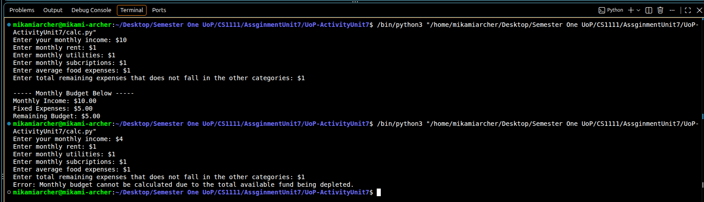

# UoP-ActivityUnit7

    Develop a step-by-step sequencing algorithm that calculates a user's monthly budget. Include prompts for the user to input their monthly income, fixed expenses (e.g., rent, utilities), and variable expenses (e.g., groceries, entertainment). Use conditional selection to handle different expense scenarios and an iterative loop to account for multiple variable expenses. Finally, calculate and display the remaining budget after deducting expenses. 

# Idea for Assignment: Error
Cannot go into negatives of overbudget/only produces floating 0.0 number in py once that threshold is met.

